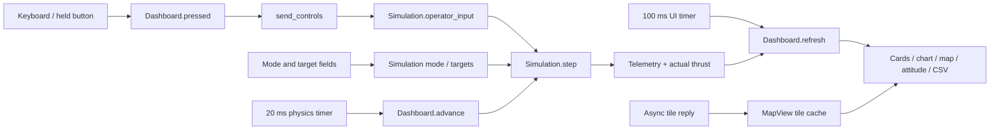

# ABYSS — ROV Telemetry Ground Station

A native Python + Qt desktop application for the Coratia Technologies internship assessment. It simulates an underwater vehicle and displays live telemetry, operator controls, a depth history, and OpenStreetMap tiles inside one desktop window.

## Reading guide

For daily use, start with **Repaired setup**. For interview preparation, read sections **5, 9, 10 and 11**. For exact software versions, see **Technology and version inventory**. The modification recipes describe where to edit; they are examples, not additional features already implemented.

- [Repaired setup](#repaired-setup-on-kirans-computer)
- [Technology and version inventory](#technology-and-version-inventory)
- [Assessment requirements](#1-understand-the-assignment)
- [Installation](#2-install-and-run)
- [Project files](#3-understand-the-files)
- [Controls](#4-operate-the-vehicle)
- [Physics and safety](#5-explain-the-simulation)
- [Map](#6-understand-the-map)
- [Verification](#7-verify-the-implementation)
- [Submission](#8-prepare-the-submission)
- [Code architecture and execution flow](#9-code-architecture-and-execution-flow)
- [Interview modification guide](#10-interview-modification-guide)
- [Interview questions and answers](#11-interview-questions-and-answers)
- [Troubleshooting and limitations](#12-troubleshooting-and-known-limitations)

## Repaired setup on Kiran's computer

The installed PySide6 6.12.0 runtime repeatedly decremented Python 3.10's `None` reference count during Qt drawing, eventually aborting Python. This was reproduced both during shutdown and during sustained drawing. Python 3.12.9 was already installed and was used to create `.venv312`; no Ubuntu upgrade was required. The new environment links the compatible Qt ABI3 packages from `.venv`, so **keep both environment directories** on this machine. A normal fresh installation elsewhere should install dependencies directly into its own environment.

Launch the repaired setup:

```bash
cd ~/CodexProjects/rov-ground-station
./run.sh
```

Or activate the repaired environment explicitly:

```bash
source .venv312/bin/activate
python main.py
```

`run.sh` prefers `.venv312` regardless of which Python environment your terminal currently has active. `requirements.txt` now excludes PySide6 6.12 and newer on Python versions before 3.12. The old incompatible launch displays a helpful message instead of starting the crashing Qt combination. Normal shutdown also explicitly stops timers, removes the event filter and destroys the window before Python finalization.

Run all checks with `.venv312/bin/python -m unittest discover -s tests -v`. The additional GUI check runs offscreen for 15 seconds, checks mode inputs and rendering, then disarms and closes the window. Interactive desktop input and network availability should still be checked manually.

The redesigned interface uses a restrained navy-and-teal palette, CORATIA / ABYSS branding, a mission overview, annotated telemetry cards, an offshore marine navigation map with a local grid, range rings, track and scale, a depth chart with shaded history, and a live artificial horizon. A dedicated command center groups arming, modes, targets and keyboard controls. Visible focus states, contextual tooltips and a scrollable control panel support desktop operation at smaller window sizes. All telemetry and attitude indications come from the simulation.

## Technology and version inventory

These values were read from Kiran's installed environments and OS package database during the documentation update on **12 November 2026**. They describe the tested local setup; another computer can resolve different versions within `requirements.txt`.

### Application technologies

| Technology | Observed version | Purpose and version meaning |
| --- | --- | --- |
| Ubuntu | 22.04.5 LTS, Jammy | Local development OS; Windows/macOS setup is documented but was not tested here |
| Linux kernel | 6.8.0-52-generic | Host kernel; the application does not require this exact kernel |
| CPU architecture | x86_64 | Architecture of the tested machine |
| Python, working environment | **3.12.9** | Interpreter used by `.venv312` and all successful repaired GUI checks |
| Python, original environment | 3.10.12 | Interpreter in `.venv`; its combination with the installed PySide6 6.12.0 crashed locally |
| PySide6 | **6.12.0** | Python bindings for Qt |
| Qt runtime | **6.12.0** | Native widget, painting, event-loop and network libraries bundled with PySide6 |
| Shiboken6 | **6.12.0** | Binding support used by PySide6; also used explicitly to destroy the window before interpreter shutdown |
| TOMLI | 2.5.0 | Installed support package; the application does not directly import it |
| Qt Widgets | Part of Qt/PySide6 6.12.0 | Native window, cards, buttons, spin boxes, combo box, dialogs and layouts |
| Qt Core | Part of Qt/PySide6 6.12.0 | Timers, signals, events, points, rectangles, URLs and cache paths |
| Qt GUI | Part of Qt/PySide6 6.12.0 | QPainter, fonts, gradients, paths, pens and tile images |
| Qt Network | Part of Qt/PySide6 6.12.0 | Asynchronous HTTPS map downloads and network disk cache |
| OpenStreetMap raster tiles | Live external service; no fixed application package version | Base map at `tile.openstreetmap.org`; tile content can change independently of the source code |
| Python standard library | Supplied by Python 3.12.9 | `math`, `time`, `csv`, `dataclasses`, `collections`, `pathlib`, `sys`, `unittest`, `os` and `importlib`; no separate installation/version for each |
| Qt stylesheet syntax | Supplied by Qt 6.12.0 | Styling in `STYLE`; this is Qt styling, not a browser CSS engine |

There is no NumPy, pandas, Matplotlib, PyQt, web framework, database, backend server, JavaScript, QML, ROS, MAVLink or SITL dependency. The depth chart and attitude instrument use QPainter directly. Keyboard input satisfies the assessment; joystick support is not implemented.

### Installed companion packages and packaging tools

The original `.venv` reports these additional installed packages. Their presence does not mean the application uses all of their features.

| Package/tool | Installed version | Used directly by this project? |
| --- | --- | --- |
| PySide6_Addons | 6.12.0 | No direct Addons module import |
| PySide6_Essentials | 6.12.0 | Supplies core Qt binding components |
| PySide6_Pdf | 6.12.0.140 | No; PDF rendering is not part of this application |
| PySide6_WebEngine | 6.12.0.140 | No; the embedded map uses native painting, not a web engine |
| pip | 22.0.2 in original `.venv` | Installation tool; not an application runtime dependency |
| setuptools | 59.6.0 in original `.venv` | Packaging tool; not imported by the application |

The repaired `.venv312` was created without pip and links `PySide6`, `shiboken6`, and `tomli` from the existing environment. Its package metadata lists those three packages; its Qt binaries are reached through the PySide6 directory. Do not describe the repaired environment as a freshly installed, independently locked dependency set. For a clean submission machine, create a normal environment and install `requirements.txt` there.

### Linux package versions present on this machine

These are Ubuntu package versions, which include Ubuntu revision suffixes. They are OS dependencies, not pip packages. Most users only need the installation command in section 2; this table is an inventory for troubleshooting.

| Package | Installed version |
| --- | --- |
| `python3-venv` | `3.10.6-1~22.04.1` |
| `libegl1`, `libopengl0` | `1.4.0-1` each |
| `libxcb-cursor0` | `0.1.1-4ubuntu1` |
| `libxkbcommon-x11-0` | `1.4.0-1` |
| `libxcb-icccm4` | `0.4.1-1.1build2` |
| `libxcb-image0` | `0.4.0-2` |
| `libxcb-keysyms1` | `0.4.0-1build3` |
| `libxcb-render-util0` | `0.3.9-1build3` |
| `libxcb-randr0`, `libxcb-xfixes0`, `libxcb-shape0`, `libxcb-sync1`, `libxcb-xkb1`, `libxcb-xinerama0` | `1.14-3ubuntu3` each |

`python3-venv` here belongs to Ubuntu's default Python 3.10. It does not establish that the separate Python 3.12 installation has its own `ensurepip`/venv support package.

### Dependency ranges versus tested versions

The actual `requirements.txt` contains:

```text
PySide6>=6.6,<6.12; python_version < '3.12'
PySide6>=6.6,<7; python_version >= '3.12'
```

These are installation ranges, **not a lock file**. The verified working combination is **Python 3.12.9 + PySide6/Qt/Shiboken 6.12.0**. The Python 3.10 + PySide6 6.12.0 combination crashed locally. The range and startup guard conservatively exclude that binding generation on Python before 3.12; they do not prove every other possible version combination has been tested. Older Qt versions within the first range were not installed and tested during this repair.

For a fresh Python 3.12 environment, `python -m pip install "PySide6==6.12.0"` requests the same top-level binding version as this machine; platform and transitive package details can still differ. Use a clean installation and capture its full resolved dependency list if an exact deployment environment is required.

To inspect the repaired runtime yourself:

```bash
.venv312/bin/python --version
.venv312/bin/python -c 'import PySide6, shiboken6; from PySide6.QtCore import qVersion; print("PySide6:", PySide6.__version__); print("Qt:", qVersion()); print("Shiboken:", shiboken6.__version__)'
cat /etc/os-release
```

In a normal environment with pip installed, use `python -m pip list` or `python -m pip freeze`. On this machine, `.venv/bin/python -m pip list` describes the original Python 3.10 environment, not the repaired interpreter.

## 1. Understand the assignment

The supplied PDF asks for a **desktop application**, with these features:

| Requirement | Implementation | Why it is used |
| --- | --- | --- |
| Forward, sideways, vertical movement and turning | Four simulated axes in `simulation.py` | Represents the ROV's useful motion without a complex robotics framework |
| Drag and thruster delay | Velocity damping and a 0.22-second first-order actuator response | Gives movement inertia and avoids instant full thrust |
| Armed state, mode, roll, pitch, yaw, depth, voltage | Header, control panel and telemetry cards | Lets the operator see vehicle condition at a glance; heading is yaw |
| Arm and Disarm | Main button, dedicated stop button, Escape key | Gates all thruster output |
| Manual mode | Keyboard and press-and-hold dashboard buttons | Provides operator commands without hardware; joystick is not required because the PDF allows either keyboard or joystick |
| Depth Hold | Target input and PD controller | Automatically reaches and holds a requested depth |
| Heading Hold | Target input and PD controller with angle wrapping | Automatically reaches and holds the requested direction |
| Zero thrust when disarmed | Immediate actuator reset and simulation guard | Prevents commands or hold controllers from producing disarmed thrust |
| Manual timeout | Actual thrust is forced to zero after one second without input | Prevents a stale Manual command from continuing indefinitely |
| Live depth-versus-time plot | Custom Qt painter, last 120 seconds | Makes depth changes and hold behavior visible |
| Embedded OpenStreetMap | Native Qt widget rendering downloaded OSM raster tiles | Shows estimated location without building a browser application |
| Responsive interface | Short timer callbacks and asynchronous network requests | Keeps controls responsive while physics, graphics and map loading run |
| Optional extra | CSV telemetry logging and unit tests | Supports review and verifies safety/controller behavior |

The PDF prefers C++ with Qt/QML but explicitly allows Python. This implementation uses **PySide6, the Qt Python binding**, to keep the project small enough to understand and modify at interview. It does not use a browser, JavaScript, ROS, MAVLink, SITL or hardware.

## 2. Install and run

**On Kiran's repaired machine, use `./run.sh` from the section above.** The commands below describe a fresh installation on another machine. Python 3.12 is recommended because that is the interpreter verified with the installed Qt version. Python 3.10 is permitted by the source, subject to the older binding range in `requirements.txt`; that alternative stack has not been verified here. Internet access is needed for dependency installation and uncached map tiles.

### Ubuntu / Debian

Open your own terminal and run these commands one at a time:

```bash
cd ~/CodexProjects/rov-ground-station
sudo apt update
sudo apt install python3-venv libegl1 libopengl0 libxcb-cursor0
python3 -m venv .venv
source .venv/bin/activate
python -m pip install -r requirements.txt
python main.py
```

What each command does:

1. `cd` opens the project folder.
2. `apt update` refreshes Ubuntu's package list.
3. `apt install` installs virtual-environment support and commonly needed Qt desktop libraries.
4. `python3 -m venv .venv` creates an isolated Python environment for this project.
5. `source .venv/bin/activate` selects that environment in this terminal.
6. `pip install -r requirements.txt` installs PySide6 and its Qt runtime.
7. `python main.py` opens the native dashboard.

If your system already has the listed packages, skip the two `sudo apt` commands. If `python3 -m venv` reports that `ensurepip` is unavailable, install `python3-venv`, then run the virtual-environment command again. An incomplete `.venv` can be populated by rerunning the same command; deleting the folder is unnecessary.

For subsequent launches:

```bash
cd ~/CodexProjects/rov-ground-station
source .venv/bin/activate
python main.py
```

### Windows PowerShell

Place this project in a folder, open PowerShell there, then run:

```powershell
py -m venv .venv
.\.venv\Scripts\python.exe -m pip install -r requirements.txt
.\.venv\Scripts\python.exe main.py
```

### macOS

In the project folder:

```bash
python3 -m venv .venv
source .venv/bin/activate
python -m pip install -r requirements.txt
python main.py
```

## 3. Understand the files

```text
rov-ground-station/
├── main.py                  Native dashboard, input, timers, graph, map and CSV
├── simulation.py            Vehicle state, physics, modes and safety logic
├── requirements.txt         Qt dependency
├── run.sh                   Prefers repaired .venv312, otherwise uses .venv
├── tests/
│   ├── test_simulation.py    Nine safety, movement and controller checks
│   └── test_gui.py           One sustained offscreen Qt integration check
├── WALKTHROUGH.md           Demonstration and submission checklist
└── README.md                Setup and implementation explanation
```

Start reading `simulation.py`; it has no Qt dependency. Then read `main.py` in this order: `label`/`panel`, `Metric`, `BrandMark`, `AttitudeView`, `DepthPlot`, `MapView`, `Dashboard`, `STYLE`, and `main`.

## 4. Operate the vehicle

The application starts **disarmed**, at 2 m depth and 35° heading. That initial pose is simulated; a disarmed ROV does not need to begin at the surface. The vehicle model is neutrally buoyant.

1. Select **Manual** and click **ARM VEHICLE**.
2. Hold a movement key, or hold its matching dashboard button.
3. Release the key/button to request zero thrust. Normal actuator response means thrust decays briefly on release; the watchdog forces it fully to zero after one second without input.
4. Select **Depth Hold**, set a target such as **8 m**, and watch the teal depth trace approach the dashed target line.
5. Select **Heading Hold**, set a target such as **120°**, and watch the heading card and map arrow turn.
6. Click either Disarm control or press **Escape** to cut thrust immediately.
7. Click **Start CSV recording**, choose a file, then stop recording before opening the file in a spreadsheet.

| Key | Action | Positive simulation axis |
| --- | --- | --- |
| W / S | Forward / reverse | Surge forward |
| A / D | Move left / right | Sway right |
| R / F | Ascend / descend | Heave down |
| Q / E | Turn left / right | Clockwise yaw |
| Escape | Disarm | Immediately sets every thruster to zero |

Multiple movement keys can be held together. Mode changes clear existing commands. Manual controls are disabled in hold modes. Only the selected hold axis is controlled; other axes receive zero requested thrust and slow through drag. Target fields become editable in their corresponding mode.

Keyboard release and application focus loss clear commands. Holding a key produces fresh input each physics callback rather than depending on the operating system's keyboard-repeat rate. Clicking a target field to edit numbers does not issue movement commands.

**Disarm cuts thrust, not velocity.** The vehicle can coast briefly because drag slows existing motion; this is intentional and matches the distinction between motor output and movement.

## 5. Explain the simulation

### State and coordinate conventions

`Telemetry` stores armed status, mode, elapsed time, north/east displacement, depth, yaw, roll, pitch and voltage. Depth is positive downward and restricted to 0–100 m. Heading is clockwise from north, wrapped into 0–360°. Commands and actuator outputs are normalized to −1…+1.

`Simulation.operator_input()` accepts commands only while armed and in Manual mode. `Simulation.set_mode()` validates the mode and clears commands and actuator output. `Simulation.arm()` clears stale commands, so rearming does not resume an old Manual command.

### Thruster response delay

Each output approaches its requested value using:

```text
alpha = 1 - exp(-dt / 0.22)
actual_thrust += alpha * (requested_thrust - actual_thrust)
```

This is a first-order response lag, rather than a literal dead-time queue. It gives the short thruster-response delay requested in the assessment while using very little code. Disarm and watchdog cuts bypass this response lag.

### Movement and drag

```text
velocity += (acceleration_gain * actual_thrust - drag * velocity) * dt
position += velocity * dt
```

Horizontal body velocities are rotated by yaw into north/east displacement. Turning integrates yaw velocity. Roll follows lateral thrust and pitch follows forward thrust with smoothing. These are visual approximations, not a full rigid-body attitude model. Voltage decreases slowly with simulated time and thruster load; it is an illustrative battery model.

### Depth Hold

```text
depth_error = target_depth - current_depth
heave_command = clamp(0.85 * depth_error - 0.95 * vertical_velocity)
```

This is a **PD controller**: proportional control moves toward the target, while the derivative term damps motion and reduces overshoot. Neutral buoyancy means no integral term is needed for this model. The target remains active without operator key input because the one-second watchdog applies to Manual mode.

### Heading Hold

```text
heading_error = (target_heading - current_heading + 180) % 360 - 180
yaw_command = clamp(0.035 * heading_error - 0.035 * yaw_velocity)
```

Angle wrapping chooses the shortest turn. For example, 359° to 1° produces +2°, instead of a −358° turn.

### Safety

`Simulation.step()` first determines whether thrust must be forced to zero. A disarmed vehicle cannot produce thrust, including in either hold mode. In Manual, elapsed time since the last input is checked every step; at one second, both the command and actual thrust become zero.

The dashboard also checks the input timeout against the monotonic wall clock. This prevents slow event-loop timing from extending a stale command. If an event-loop stall of at least one second is detected, held keys are cleared. A completely stalled process cannot execute safety logic until it resumes; this is a software simulator, not a hardware emergency-stop system.

### Responsive updates

- A Qt timer advances physics in fixed 20 ms steps: nominally 50 Hz.
- A separate 100 ms timer refreshes telemetry and the graph: nominally 10 Hz.
- `time.monotonic()` measures callback intervals without system clock changes.
- Physics catch-up is capped at 100 ms per callback so a long pause cannot trigger a large blocking loop. Simulated elapsed time can therefore lag real time after a long pause.
- `QNetworkAccessManager` fetches map tiles asynchronously. Slow or failed downloads do not block controls.
- The plot stores at most 1,200 samples; the in-memory map cache is limited to 80 tiles.

## 6. Understand the marine navigation map

The map is designed for a simulated underwater ROV operating **offshore near Visakhapatnam in the Bay of Bengal**. The launch position is **17.7000° N, 83.3400° E**, replacing the previous inland street location. It remains a native Qt widget using OpenStreetMap raster tiles, as required by the assessment. No new map library or web engine is used.

### What the operator sees

| Element | Meaning |
| --- | --- |
| Muted coastal OSM basemap | Real geographic context with a navy tint so navigation overlays remain readable |
| North arrow | The map stays north-up; the vehicle arrow rotates with yaw |
| ROV-01 marker and label | Current simulated horizontal position, depth and heading |
| Launch cross | Fixed start/reference position, not a support vessel or GPS measurement |
| Dashed 250 m, 500 m and 1,000 m rings | Horizontal distance references centered on launch |
| Metre grid | Local position reference anchored to launch; spacing adjusts to zoom |
| Teal track | Actual simulated position history; no route is fabricated at startup |
| Scale bar | Ground distance at the current zoom and latitude |
| From-launch distance | Straight-line horizontal displacement, not travelled path length or tether length |
| OSM attribution | Identifies the basemap's geographic data source |

The initial zoom is **14**; +/− controls allow zoom levels **12–18**. The map follows the ROV. The trail stores at most **1,200 positions**, accepting a new point only after at least **1 m** displacement from the last accepted point. Thus trail retention is distance/sample based, not a fixed number of seconds. The chart history is separate.

Position is estimated by converting simulated north/east displacement around the launch coordinates. It is **not underwater GPS**. The map uses Web Mercator tiles, with approximate local resolution:

```text
metres_per_pixel = 156543.03392 * cos(latitude_in_radians) / 2**zoom
```

This resolution determines the ring radii, grid spacing, track placement and scale bar. Local coordinates and map projection are approximations suitable for the small simulation area, not surveying software.

**The map contains no measured bathymetry, depth soundings, sonar, surveyed obstacles, tidal data or certified nautical chart information.** The vehicle's depth label is simulated telemetry, not seafloor depth. The grid and rings are visual references; they do not enforce a geofence or limit movement. The coastal launch point is a geographic demonstration choice, not a surveyed safe operating site. Do not present these overlays as navigation-grade marine data during the interview.

Map imagery needs internet access on first load. Qt caches tiles on disk, so already cached areas may work offline. Missing tiles show a loading/unavailable message while simulation and local overlays continue. The interface does not substitute an invented coastline when the basemap is unavailable.

The marine redesign passed the ten-test suite and offscreen rendering check. Downloads for the new offshore area were unavailable in the agent environment, so live coastal tile delivery still needs a check from your internet-connected desktop. The screenshot from this update shows the explicit offline state and functioning navigation overlays.

### Where to change the marine map

- `MapView.LAT`, `MapView.LON`: launch coordinates.
- `MapView.__init__()`: initial zoom, track capacity and cache settings.
- `MapView.set_position()`: telemetry values and the 1 m track acceptance threshold.
- `MapView.paintEvent()`: basemap tint, rings, adaptive grid, track, north arrow, scale and overlay labels.
- `Dashboard.__init__()`: mission subtitle and Marine navigation panel heading.
- `Dashboard.refresh()`: displayed geographic coordinates below the map.

The basemap tint is `QColor(7, 23, 39, 178)`, painted after tiles and before navigation overlays. The last value is alpha; reduce it to reveal more of the original map. Ring distances are the tuple `(250, 500, 1000)` in metres. Grid/scale spacing is selected from `(50, 100, 250, 500, 1000, 2500, 5000)` so grid cells remain at least 45 pixels wide. If the zoom limits change, verify that this spacing list still covers the new range.

This interactive assessment viewer requests visible tiles, supplies an identifying user agent and uses caching. It does not bulk-download charts. Review the [OSM tile usage policy](https://operations.osmfoundation.org/policies/tiles/) before distributing at scale. A future genuine nautical layer would need a suitable provider, attribution/licensing, source quality checks and a clear distinction between measured data and simulation.

## 7. Verify the implementation

Run the complete suite in the repaired environment:

```bash
.venv312/bin/python -m unittest discover -s tests -v
```

This runs nine simulation checks plus one approximately 15-second offscreen GUI check. To run only the dependency-free simulation tests:

```bash
python3 -m unittest discover -s tests -p 'test_simulation.py' -v
```

The nine tests cover all movement axes, disarmed output in every mode, immediate disarm, Manual timeout, thruster response, drag, hold convergence, shortest heading turn, depth bounds, rearming and mode changes.

For a local screenshot after installing Qt:

```bash
./run.sh --screenshot
```

This opens the real application, waits five seconds, saves `dashboard.png` beside `main.py`, and exits. It captures live simulation values; it does not inject fabricated sample data. A working desktop session is required for a normal on-screen screenshot.

**Verification:** all nine simulation tests and Python syntax compilation passed initially. During the subsequent crash repair, the installed Qt packages were tested using the existing Python 3.12 interpreter. All ten tests passed, including the 15-second offscreen GUI regression covering mode inputs, rendering, disarm and clean shutdown. The screenshot command also completed successfully and produced `dashboard.png`. Interactive keyboard/mouse behavior and CSV dialogs still require the desktop checks in `WALKTHROUGH.md`.

## 8. Prepare the submission

Follow `WALKTHROUGH.md` for the recording. Include the source, launcher, requirements, README, tests and your video. Exclude `.venv`, `.venv312`, `__pycache__` and personal recordings/logs unless specifically requested. Keep both environments locally; excluding them from the submission does not mean deleting them from this machine.

The PDF asks for an **interface walkthrough only**. You must still understand the movement, controllers and safety logic for interview questions. Do not claim working UI verification until you have launched and checked it locally.

## 9. Code architecture and execution flow

### The main idea

`simulation.py` owns vehicle state and control rules. `main.py` owns how the operator sees and changes that state. The model does not import Qt, so its behavior can be checked without a desktop. `Dashboard` currently coordinates the model and widgets; this is a small separation of concerns, not a complete MVC framework.



### What happens after launch

1. `run.sh` finds its own directory and selects `.venv312/bin/python` when available. Arguments such as `--screenshot` are forwarded to `main.py`.
2. `main()` checks the Python/binding combination, creates one `QApplication`, selects Fusion styling, and applies `STYLE`.
3. `Dashboard.__init__()` creates `Simulation`, widgets, input connections and the two timers. It also installs an application event filter.
4. The Qt event loop dispatches input, timer, repaint and network completion events. There is no Python `while True` loop blocking the window.
5. `advance()` measures wall time, checks stale input, and advances the model in fixed 0.02-second steps.
6. `refresh()` reads the latest model state and updates the displays. Qt schedules custom widget painting through `update()`.
7. Closing the window disarms and closes the CSV file. After the event loop returns, `main()` removes the event filter, stops timers, closes the window and explicitly destroys it while Python is still active.

### Model reference: `simulation.py`

| Symbol | Responsibility | Interview point |
| --- | --- | --- |
| `clamp(value, low, high)` | Limits a number; defaults to −1…+1 | Thruster commands must remain bounded |
| `heading_error(target, current)` | Returns signed shortest heading error | Avoids long turns across north |
| `Telemetry` | Dataclass with named state fields and startup defaults | A small data container; it does not update itself |
| `Simulation.__init__()` | Creates state, targets, commands, thrust, velocities and input timestamps | Each simulation instance has independent mutable lists |
| `arm(enabled)` | Changes armed state and clears commands/output/input history | Hold controllers can resume on the next step when armed; Manual requires new input |
| `set_mode(mode)` | Validates mode and clears command/output history | Prevents old Manual commands leaking into a new mode |
| `operator_input(...)` | Accepts bounded commands only in armed Manual mode | Model enforces the rule even if the UI misbehaves |
| `step(dt)` | Applies safety, selects controller, updates actuators, integrates motion and telemetry | The core function to explain and test |

The four-element lists always use this order:

```text
index             0         1          2             3
meaning           surge     sway       heave         yaw
positive          forward   right      downward      clockwise
velocity units    m/s       m/s        m/s           degrees/s
```

`command` is the requested operator input. `thrust` is actual normalized actuator output after lag and safety. `velocity` is resulting motion. They are different quantities. `last_input` uses simulated seconds; `last_operator_event` in the dashboard uses monotonic wall-clock seconds. `-math.inf` means no valid recent input.

### UI reference: `main.py`

| Class/helper | Main methods and purpose |
| --- | --- |
| `label()` | Creates consistently styled text; explicit inline sizes/colors override stylesheet defaults |
| `panel()` | Creates a `QFrame` with object name `panel`, used by the stylesheet selector |
| `Metric` | Builds a telemetry card; `Dashboard.refresh()` updates its `value` label |
| `BrandMark` | Paints the decorative brand mark; no telemetry or input behavior |
| `AttitudeView` | `set_state()` copies roll/pitch/yaw; `paintEvent()` rotates/translates an artificial horizon and displays heading |
| `DepthPlot` | `add()` stores time/depth/optional target; `paintEvent()` draws grid, axes, target, shaded history and measured trace |
| `MapView` | Converts coordinates to tiles, requests/caches tile images and paints map overlays |
| `Dashboard` | Builds layouts, handles input/modes/arming, owns timers and CSV recording |
| `STYLE` | Qt stylesheet string for global colors, frames, controls, hover/focus/disabled states and scrollbars |
| `main()` | Runtime check, Qt startup, screenshot option, event loop and orderly cleanup |

### Dashboard methods to know

| Method | Called by | What changes |
| --- | --- | --- |
| `set_depth_target`, `set_heading_target` | Spin box `valueChanged` signals | The corresponding model target |
| `release_control` | Key release or button release | Removes one held key and immediately sends remaining/zero inputs |
| `send_controls` | Held-input physics callbacks and releases | Converts the key set to four axis commands; opposite keys cancel |
| `eventFilter` | Qt application events | Tracks key presses/releases, ignores autorepeat, handles focus loss and Escape, protects target-field editing |
| `toggle_arm` | Main Arm/Disarm button | Clears held keys, toggles model arming, refreshes UI |
| `disarm` | Stop button or Escape | Clears keys and forces disarm, then refreshes |
| `change_mode` | Combo box signal | Changes model mode, clears keys, enables relevant targets and Manual buttons |
| `advance` | Physics timer | Wall-clock safety check and fixed-step model updates |
| `refresh` | UI timer and immediate action feedback | Cards, state labels, graph, map, horizon, coordinates, actual thrust and CSV row |
| `toggle_logging` | Recording button | Opens save dialog and CSV file, writes header; toggles recording off if already active |
| `stop_logging` | Recording toggle, error or close | Closes file and clears writer state |
| `closeEvent` | Window closing | Disarms and stops logging |

### Map methods and caching

`tile_xy()` uses Web Mercator tile coordinates at the current zoom. `paintEvent()` calculates visible 256×256 tiles, requests missing ones, paints cached tiles, then applies the navy tint and draws the local grid, launch range rings, real simulated trail, vehicle marker, north arrow and scale. `request_tile()` suppresses duplicate pending requests and retries failed keys after 30 seconds. `tile_finished()` decodes a successful image, stores it, and requests another repaint; it deletes the completed reply afterward. `set_position()` updates model-derived position and heading. `change_zoom()` restricts zoom to 12–18.

The disk cache is capped at 50 MiB. The in-memory `OrderedDict` retains up to 80 tiles using insertion-order eviction; cache hits are not moved to the end, so this is not a full least-recently-used cache. The failed-key dictionary is not explicitly bounded. Mention these details accurately if asked about scaling.

## 10. Interview modification guide

Search by the named function or literal shown below; line numbers can change after edits. Before changing behavior, state what should change, find every place that assumes the old value, make the smallest coherent edit, and run the relevant checks. Keep the assessment's one-second timeout and disarmed zero-thrust requirement unless the interviewer explicitly asks for a different design.

### A. Change colors, fonts, branding or spacing

1. Open `main.py` and find `BG`, `PANEL`, `TEXT`, `MUTED`, `CYAN`, `BLUE`, and `STYLE`.
2. Update both the constants used by custom painting and the literal colors in `STYLE`. Some decorative colors and label styles are inline; this project does not yet have a single complete theme configuration.
3. Change header text in `Dashboard.__init__()` and the mark in `BrandMark.paintEvent()`.
4. Change `outer.setContentsMargins`, layout `setSpacing`, `setContentsMargins` and `self.resize(1400, 920)` for layout adjustments. The minimum window size is 1100×780; controls scroll when necessary.
5. Relaunch or run `./run.sh --screenshot`. Check normal, armed, hold-mode, disabled, hover and keyboard-focus appearances. A Qt stylesheet change does not change physics.

To change decimal precision, edit formatting in `Dashboard.refresh()`; for example, depth currently uses `f"{value:.1f}"`. This changes presentation, not model precision.

### B. Change startup depth, heading or battery

Find defaults in `Telemetry`. Keep initial targets and input widgets consistent:

| Desired change | Places to check |
| --- | --- |
| Start at 5 m | `Telemetry.depth`, `Simulation.target_depth`, `self.depth_target.setValue(...)` |
| Start facing 90° | `Telemetry.yaw`, `Simulation.target_heading`, `self.heading_target.setValue(...)`; map's temporary initial yaw if needed |
| Start at 16.0 V | `Telemetry.voltage`; battery model lower bound and any future thresholds |

Example: use `5.0` in the first three depth locations to start at 5 m with a matching hold target. Update tests that intentionally assert startup values. Initial state values do not imply the application should start armed; retain `armed=False`.

### C. Make the vehicle accelerate faster or stop drifting sooner

In `Simulation.step()`, the force gains are `(1.4, 1.1, 1.0, 70.0)` and drag coefficients are `(0.9, 1.1, 1.2, 1.8)`, in surge/sway/heave/yaw order.

- Increasing a force gain produces stronger acceleration and increases steady speed for unchanged drag.
- Increasing a drag coefficient damps existing velocity faster and lowers steady speed.
- In this linear model, approximate steady velocity under a constant output is `force_gain * thrust / drag`.

For example, change only the first force gain from `1.4` to `1.8` for stronger forward/reverse acceleration. Then check both directions, coasting, timeout and disarm. Changing heave or yaw dynamics can require retuning hold gains.

### D. Make thruster response faster or slower

Change `Simulation.RESPONSE_TIME`, currently `0.22` seconds. A smaller positive value responds faster; a larger value responds more slowly. It must stay greater than zero because the response formula divides by it. A time constant is not a hard waiting period: output begins changing on the first step and approaches its target smoothly. At one time constant, it has reached approximately 63% of a constant command. Preserve the hard-zero safety path.

### E. Tune Depth Hold or Heading Hold

Find the corresponding `desired[2]` or `desired[3]` formula in `Simulation.step()`.

1. Identify proportional gain and velocity damping separately.
2. Change one gain at a time, in small increments.
3. Try small and large target changes; observe settling time and overshoot.
4. Check target saturation and heading wrap-around, then run convergence tests.

Increasing depth proportional gain above `0.85` generally produces a stronger response to error, but actuator lag can cause oscillation. Increasing the `0.95` damping term can reduce overshoot but slow the response. Heading uses `0.035` for both terms; its velocity unit is degrees/second, so do not copy depth gains blindly. `clamp` limits requested output even for a large error. There is no integral term in the current model.

### F. Change maximum depth

The current 100 m limit appears in `Simulation.step()` twice: the boundary condition and the `clamp` upper limit. The UI limit is `self.depth_target.setRange(0, 100)`. Update all three, along with documentation and any depth-bound tests. Changing only the spin-box range cannot change the physics boundary. Check both the surface and the new maximum, including velocity being reset at either boundary.

### G. Explain or modify the Manual timeout

The current timeout is intentionally one second, as required by the PDF. It is implemented in more than one place:

- `Simulation.INPUT_TIMEOUT = 1.0` for model elapsed-time checks.
- `Dashboard.advance()`: `wall_dt >= 1.0` for clearing held input after a long callback gap.
- `Dashboard.advance()`: `now - self.last_operator_event >= 1.0` for real-time stale input.
- The visible `1 s timeout` status text and the watchdog test assume the same behavior.

If explicitly asked to make this configurable, replace the dashboard literals and status text with the model setting, define whether the long-stall threshold should share it, and update tests. Changing only `INPUT_TIMEOUT` leaves inconsistent wall-clock behavior. The guard must zero **actual thrust**, not merely the desired command. Never apply the Manual idle timeout to a hold controller that is supposed to operate without key input.

### H. Change keys or reduce Manual power

Key bindings appear in three places in `main.py`: `Dashboard.KEYS`, the Manual button `(text, key)` list, and `send_controls()`'s positive/negative axis pairs. Update all three and the README key table. Preserve Escape disarm.

To limit Manual thrust to 50%, change the axis helper in `send_controls()` to:

```python
axis = lambda positive, negative: 0.5 * (float(positive in k) - float(negative in k))
```

This scales only Manual requests; hold controllers keep their existing authority. Keep the model clamp because the model should validate inputs independently of the interface.

### I. Change timer frequency

Physics currently uses `physics_timer.start(20)` and an accumulator with `0.02` seconds in the loop condition, `step()` call and subtraction. For a 100 Hz model, change the timer interval to `10` ms and **all three** fixed-step values to `0.01`. Preserve the `dt` validation in the model and recheck controller behavior. Changing just the timer interval changes callback scheduling, not the fixed integration step.

The UI uses `ui_timer.start(100)` for nominal 10 Hz refresh. If changed to `50`, nominal UI sampling becomes 20 Hz, affecting graph capacity and CSV frequency. The footer rate text is static and must be updated too. A timer interval is a request, not a guarantee of hard real-time scheduling.

### J. Show five minutes of depth history

In `DepthPlot`, change `end - 120` to `end - 300`, `span = 120.0` to `span = 300.0`, and increase `deque(maxlen=1200)` to at least `3000` for nominal 10 Hz sampling. Update comments/labels. `refresh()` also runs after some button actions, so samples and CSV rows are not exactly periodic; capacity is an approximate time allowance. For strict retention, remove samples by timestamp instead of relying only on a count limit.

### K. Change map location, zoom or network behavior

Change `MapView.LAT` and `MapView.LON` for the launch point. `self.zoom = 14` sets initial zoom; `change_zoom()` limits it to 12–18. Update the visible operating-area text in `Dashboard.__init__()` too. Keep attribution and the identifying user agent.

`setTransferTimeout(8000)` means an 8,000 ms network timeout. The failed-key retry interval is 30 seconds in `request_tile()`. Cache limits are set in `MapView.__init__()` and `tile_finished()`. A different tile provider needs its own URL, attribution and usage terms; an OSM data attribution alone does not grant permission to use another provider's tile servers. Coordinates printed in `refresh()` currently use fixed N/E suffixes, so changing to southern/western locations also requires hemisphere formatting changes.

### L. Add a telemetry field or CSV column

For example, to show total horizontal speed:

1. Calculate `speed = math.hypot(self.sim.velocity[0], self.sim.velocity[1])` in `Dashboard.refresh()`.
2. Add a `Metric("Speed", "m/s", BLUE)` card in the construction loop.
3. Add a matching `"Speed"` description to the `notes` dictionary inside `Metric`; otherwise its lookup raises `KeyError`.
4. Add the speed value to the refresh value list. Consider layout width when adding a sixth card.
5. For CSV, add `speed_m_s` to the header in `toggle_logging()` and the corresponding computed value at the **same position** in the row in `refresh()`.

If a new value must exist independently of the interface, add it to `Telemetry` or expose a model calculation, then update it in the model. Do not duplicate ownership of the same changing state in two places.

### M. Add a combined Depth + Heading Hold mode

This is an extension, not an existing mode. It needs coordinated changes:

1. Add the mode name to `Simulation.MODES`.
2. Add an explicit branch in `Simulation.step()` that calculates both `desired[2]` and `desired[3]`.
3. Update `Dashboard.change_mode()` so both target fields are enabled in that mode.
4. Update `refresh()` so the graph target also appears for the combined mode.
5. Test both convergence errors, mode transitions, disarm and stale Manual commands.

Do not only append a mode name: the current final `else` controller branch assumes Heading Hold, so a newly added mode would otherwise silently use only the heading controller. Keep disarm as the top-level invariant around every controller.

### N. Add water current, joystick input or real hardware later

These are design proposals, not implemented features. A small simulated current could be added as north/east drift during position integration; document that a disarmed ROV can drift with the water. A more physical model would apply drag to velocity relative to water. Add tests for the chosen behavior.

A joystick adapter should normalize axes and call the same model input interface, update the input heartbeat, handle device disconnect and preserve the disarm/watchdog checks. Real hardware would additionally need communications, measured telemetry, actuator mapping, independent safety handling and a clear separation between commanded and reported armed state. The four simulation axes are not a real vehicle's individual thruster mixer.

### After any interview edit

```bash
# Check syntax without starting the desktop application.
.venv312/bin/python -m py_compile main.py simulation.py

# Fast model checks.
.venv312/bin/python -m unittest discover -s tests -p 'test_simulation.py' -v

# Include the offscreen GUI check when changing widgets or their connections.
.venv312/bin/python -m unittest discover -s tests -v

# Review visible layout changes on the real desktop.
./run.sh
```

For a deliberate behavior change, update an affected expectation to the new requirement; do not remove a failing safety test just to get a passing result. The tests exercise important behaviors, but they do not cover every input combination or prove production readiness.

## 11. Interview questions and answers

| Likely question | Answer grounded in this implementation |
| --- | --- |
| Why Python instead of C++? | The PDF allows Python. PySide6 provides a native Qt UI while keeping the simulation compact and readable. C++/QML is preferred in the brief, so explain this tradeoff directly. |
| Why a dataclass? | It gives telemetry named fields and explicit defaults without repetitive constructor code. Mutable command/velocity lists are created separately per simulation instance. |
| Is this multithreaded? | The application code runs simulation and UI callbacks on one Qt event loop. Network operations are asynchronous. We do not create a Python worker thread. |
| Why does it stay responsive? | Physics steps and repaint work are small, catch-up is bounded, and map downloads do not block on synchronous network calls. |
| Why 50 Hz physics and 10 Hz display? | The model gets smaller integration steps while the UI performs less frequent label/chart work. Both are nominal timer rates, not guaranteed real-time rates. |
| Why use monotonic time? | Timeout measurements should not change when the system clock is adjusted. |
| How is movement integrated? | Explicit updates calculate new velocity from thrust and drag, then integrate position using that updated velocity; this is a simple semi-implicit Euler-style update. |
| Is it a realistic underwater simulator? | It captures four axes, lag and linear drag. It assumes neutral buoyancy and approximates attitude and battery behavior. It has no full fluid dynamics or rigid-body rotational dynamics. |
| Why PD rather than PID? | For this simplified neutrally buoyant model, position error and velocity damping converge without a steady external load. Integral control is unnecessary here; real bias or current could require a different controller. |
| What happens at 359° → 1°? | Wrapped error is +2°, so the controller takes the short clockwise turn. Exactly opposite headings have two equally short choices; the formula returns −180°. |
| What happens if forward and reverse are held? | Their Boolean key states subtract to zero. The same cancellation applies to the other opposite-key pairs. |
| Why can it move after disarming? | Output becomes zero immediately, but existing velocity decays through drag. Disarm is not a teleport or instantaneous velocity reset. |
| Does changing modes disarm? | No. It clears commands and output, preserves armed state, and the selected hold controller can produce output on the next simulation step. |
| Does the Manual timeout stop hold modes? | No. Hold modes intentionally continue calculating control without repeated key input. Disarm still overrides them. |
| What if the app loses focus? | Held inputs are cleared and zero Manual input is sent. Normal actuator lag applies until the hard timeout; this is not an immediate disarm. |
| Does the map use underwater GPS? | No. It converts simulated north/east displacement into approximate geographic coordinates around a fixed launch point. |
| What if the internet goes down? | Physics and local controls continue. Cached imagery may remain; missing tiles show a loading/unavailable state. |
| Why not use Matplotlib? | A small custom QPainter plot is enough for one signal and avoids another dependency. Advanced zoom/export would justify a plotting library. |
| Are CSV rows exactly 10 Hz? | No. They are written in `refresh()`, called by the nominal 10 Hz timer and some immediate control actions. File writes are synchronous and buffered. |
| Why did Python crash? | Locally, repeated Qt calls under Python 3.10 with the installed PySide6 6.12 runtime exhausted `None` references. The tested repair uses the already installed Python 3.12.9. This is an observed local compatibility issue, not proof that every Python 3.10/Qt combination fails. |
| What would you improve for production? | Centralize duplicated settings, separate UI construction from coordination, use timestamp-based plot retention, improve logging/error handling, expand input and safety tests, and validate packaging on target operating systems. |
| How was AI used? | Codex generated and refined code/docs/tests and helped diagnose the runtime issue. Explain what you personally ran, reviewed and changed; do not claim independent authorship of generated work. |

Suggested preparation order: trace one W key press from `eventFilter()` to position update; explain disarm; explain Depth Hold; explain heading wrapping; make a small UI edit; change a dynamics gain and check behavior; read the version/repair explanation. Practice understanding the code rather than memorizing this answer table.

## 12. Troubleshooting and known limitations

| Symptom | What to check |
| --- | --- |
| `ModuleNotFoundError: PySide6` | Use `./run.sh` or the intended environment's Python; check which interpreter is active |
| Python 3.10/Qt incompatibility message | Use `.venv312`; do not launch with the original Python 3.10 binding combination |
| `.venv312` cannot find Qt after cleanup | Its Qt packages link into `.venv`; restore the original folder or build a fresh, independent Python 3.12 environment |
| `.venv312/bin/python -m pip` fails | That repaired environment has no pip; this is expected. Use a fresh normal environment with pip for independent installation |
| `ensurepip` unavailable during venv creation | Install the venv support package matching that Python version; Ubuntu's default `python3-venv` can refer to a different interpreter |
| Qt platform plugin or display connection error | Launch from your desktop terminal. Restricted agent/headless sessions may not access Wayland/X11. Check actual `ldd` missing-library output before installing packages; a generic Qt warning is not proof a library is absent |
| Map says unavailable | Check network access; failed tiles can retry after 30 seconds. Cached areas may work without internet |
| Target field is disabled | Select the corresponding hold mode; Manual deliberately disables both fields |
| Arm succeeds but Manual does not move | Hold a valid movement key/button; fresh input is required. Check active window, mode and displayed thrust |
| UI cards update but motion looks unchanged | Wait while holding input; small displacement may not be visually obvious at map zoom 14. Inspect depth, heading or recorded displacement |
| CSV does not update immediately in another program | Writes are buffered. Stop recording to close/flush the file before opening it |
| Lower controls are hidden in a smaller window | Scroll the command panel; use a larger window for the recording |
| A visual edit does not show up | Close the previous process and relaunch; check inline label/painting colors as well as `STYLE` |

Current implementation limits to explain honestly:

- The attractive desktop layout is an assessment implementation, not a certified industrial ground station. Windows and macOS have not been tested locally.
- Timers and safety logic share the UI process. A frozen process cannot execute a software stop until it resumes. Hardware needs independent safety measures.
- The model has no obstacles, collisions, water current, joystick, telemetry transport, real thruster mapping or physical battery discharge model.
- Linear drag, attitude response and local coordinate conversion are approximations. Targets are bounded by the UI; arbitrary external assignments to model target attributes are not separately validated.
- A scalar depth boundary is checked in physics. Disarming does not reset pose or velocity. Restarting resets the entire simulation; settings are not persisted.
- Map tiles rely on an external service and cache. The in-memory tile cache is insertion ordered, and failed-key tracking has no explicit bound.
- Graph and CSV sampling happen in UI refresh, so occasional duplicate timestamps and extra samples after actions are possible. The chart's vertical axis increases downward to match depth.
- CSV writes occur on the event-loop thread. They are small for this demo, but slow storage could stall the UI; a queued writer would be a future improvement.
- The crash workaround is locally verified; dependency ranges are not a guarantee across every interpreter, operating system or future Qt release.

## AI tool disclosure

OpenAI Codex was used to read the assessment, generate the Python/Qt application and documentation, write and run tests, investigate a Python 3.10/Qt crash, create the repaired Python 3.12 environment, and verify offscreen rendering and shutdown. Interactive desktop operation has not been fully verified by the agent. The candidate should review, run, understand and adapt the code before submission, and describe any further AI assistance accurately.
